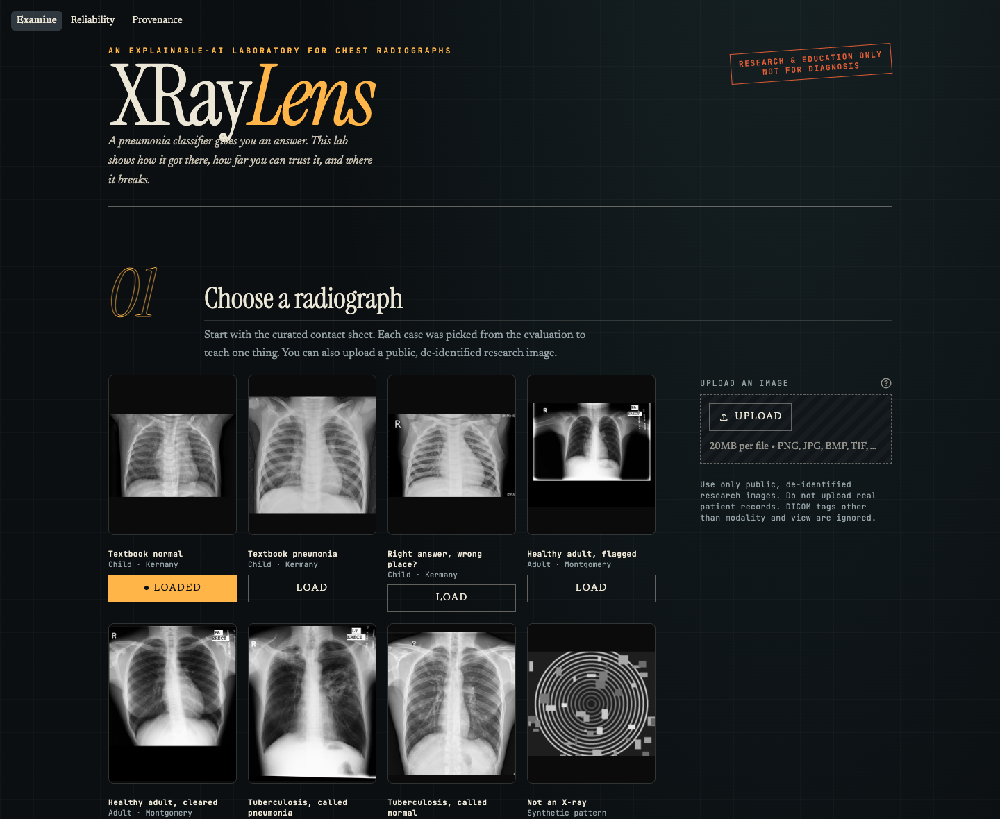

# XRayLens AI

**An explainable-AI laboratory for chest radiographs.** XRayLens runs a real ResNet-50 pneumonia classifier, shows
where it looked (Grad-CAM), checks whether that explanation can be trusted, stress-tests the prediction, and puts it
all next to an honest evaluation on 1,462 images from four cohorts.

**Live demo: https://xraylens-ai.vercel.app**. The model runs in your browser, so uploaded images never leave your device.

> **Research and education only. Not a medical device.** Nothing XRayLens displays is medical advice. Do not
> upload real patient records.



---

## What it does

| Step | What you see | Why it matters |
|---|---|---|
| **01 Choose** | A contact sheet of 8 teaching cases, each picked from the evaluation by a fixed rule, plus PNG/JPEG/**DICOM** upload | Each case teaches one thing: memorisation, shortcuts, out-of-scope disease, out-of-domain input |
| **02 Read** | The label, both softmax scores, the logit margin and a saturation flag, plus how this score compares with 400 external adult images | Separates *model output* from *probability of disease* |
| **03 Explain** | Grad-CAM for either class, heat share on padding, the image frame and radiologist lung masks, **always against area share**, plus a live **randomisation sanity check** | Shows where the model looked and whether the map actually depends on the learned weights |
| **04 Stress** | Eight anatomy-preserving edits (crop, noise, burned-in markers, inversion…) re-scored live | Shows how fragile the prediction is |
| **Reliability** | Leakage comparison, live threshold explorer, confusion matrix, ROC, per-image strip chart, calibration, Grad-CAM-vs-lung-mask analysis, robustness | Measured performance instead of claims |
| **Provenance** | Model card audit, data lineage, licences, citations | You know exactly what was tested and how |

## Headline findings (all reproducible: `results/metrics.json`)

| | n | Sensitivity | Specificity | AUC |
|---|---|---|---|---|
| Kermany "test" folder, **seen in training**, not a valid test | 624 | 100% (99.0–100) | 97.4% (94.5–98.8) | 1.000 |
| **RSNA adults, external** (normal vs lung opacity) | 400 | 99.5% (97.2–99.9) | **38.5% (32.0–45.4)** | 0.913 (0.883–0.939) |

95% CIs: Wilson for proportions, stratified bootstrap (1,000 reps) for AUC. Threshold 0.5, as shipped.

- **The leakage trap.** The model card states that the final weights were refit on *all* Kermany images, test folder
  included. The usual benchmark therefore reports AUC 1.000, which measures memory, not skill.
- **Normal adults are called pneumonia** 61.5% of the time on RSNA (123/200), 52.5% on Montgomery (42/80) and
  20% on Shenzhen (10/50). Of 200 RSNA images with *other* abnormalities, 93.5% are called pneumonia.
- **Good ranking, wrong threshold.** AUC 0.913 is respectable. Reaching 80% specificity needs a threshold of
  0.9999855 (sensitivity then 91.5%). These thresholds were chosen on the same images, so they are optimistic.
- **Overconfident.** 76% of RSNA outputs are below 0.001 or above 0.999. Expected calibration error is 0.31. In the top
  score bin (mean 0.997), only 65% of images have opacity.
- **Shortcut evidence.** Burning a text marker into the corner flipped 91 of 838 external labels toward PNEUMONIA
  and **0** toward NORMAL. Sensor noise: 153 vs 0. Inversion: 206 vs 3. In the gallery's "Healthy adult, flagged" case
  the Grad-CAM peak sits on the "PA ERECT" marker, and cropping the frame away turns the call to NORMAL.
- **Grad-CAM does favour lungs, modestly.** On Montgomery images with radiologist lung masks, lungs hold a median
  27% of the heat while covering 21% of pixels (enrichment ×1.24; 74% of images above ×1).

The model was not trained by us. It is
[Purino/resnet50-chest-xray-pneumonia](https://huggingface.co/Purino/resnet50-chest-xray-pneumonia), pinned at
revision `da2a7724bfa5`, chosen *because* its card documents its limits candidly. XRayLens is the audit instrument.

## Quick start

```bash
git clone <this repo> xraylens-ai && cd xraylens-ai
python3.12 -m venv .venv && source .venv/bin/activate      # Windows: .venv\Scripts\Activate.ps1
pip install -r requirements.txt
streamlit run app.py
```

The first run downloads the 94 MB weights from Hugging Face into `models/`. The gallery and evaluation results are
committed, so the app works with no dataset download. Inference uses CUDA, Apple MPS or CPU, whichever is
available. On CPU, one image (prediction, two Grad-CAMs and eight perturbations) takes a few seconds.

### Reproduce the evaluation

```bash
pip install -r requirements-dev.txt
python scripts/fetch_eval_data.py      # ~150 MB into data/eval (git-ignored); fixed seed 20261020
python scripts/run_evaluation.py       # ~10 min on an M1 (MPS); writes results/
python scripts/build_gallery.py        # re-picks gallery cases from results/
pytest -q                              # 20 tests
```

Every dataset is pinned to a Hugging Face commit hash in `scripts/fetch_eval_data.py`.

## How it works

```
upload / gallery ─► inputs.py ─► model.py ─────────► scores, label
 (PNG, JPEG, DICOM)  validate,    letterbox 320 px,
                     warn         ResNet-50
                                      │
                                      ├─► explainability.py ─► Grad-CAM (logit-difference), area-normalised
                                      │                        attribution, randomisation sanity check
                                      └─► perturbations.py ──► 8 edits, re-scored
results/scores.csv ─► evaluation.py ─► live metrics at any threshold (Reliability page)
```

| File | Responsibility |
|---|---|
| `app.py` | Streamlit entry point and navigation |
| `views/examine.py` | Steps 01–04 |
| `views/reliability.py` | Evaluation dashboard, recomputed live from per-image scores |
| `views/provenance.py` | Model card audit, data lineage, citations |
| `xraylens/model.py` | Weight download, preprocessing identical to the model card's `inference.py`, inference |
| `xraylens/explainability.py` | Grad-CAM, overlay, attribution statistics, randomisation test |
| `xraylens/inputs.py` | Upload validation: size, format, truncation, decompression bombs, DICOM, warnings |
| `xraylens/perturbations.py` | The eight stress-test edits |
| `xraylens/evaluation.py` | Metrics, Wilson CIs, bootstrap AUC, calibration |
| `xraylens/ui.py` | Theme CSS, HTML components, Altair theme |
| `scripts/` | Data fetch, evaluation, gallery builder |
| `tests/` | Preprocessing parity, input handling, Grad-CAM properties, metric correctness |

### Design decisions worth knowing

- **Grad-CAM uses the logit difference (z_target − z_other), not the softmax.** This model saturates, and softmax
  gradients vanish at saturation, so softmax Grad-CAM would be blank on exactly the most confident images.
- **Attribution is always shown against area.** "27% of heat on the lungs" means nothing until you know the lungs
  cover 21% of the image. A uniform map scores ×1.00.
- **Preprocessing parity is tested** against the model card's reference code (`tests/test_preprocessing.py`).
  Silent preprocessing drift is a classic way to break a medical model.
- **The input checks were measured**, not just written. The inversion detector warns on 5 of 1,462 genuine
  radiographs (0.3%) and catches 99.6% of their inverted copies. No check can prove an image is a chest X-ray. The
  "Not an X-ray" gallery case shows the model scoring a synthetic pattern PNEUMONIA 0.96.

## Limitations

- **No valid in-distribution test.** All Kermany images trained the final weights, so pediatric performance is unmeasured.
- **External cohorts are adults.** Population shift and generalisation error are confounded.
- **Label mismatch.** RSNA "Lung Opacity" is not confirmed pneumonia. Montgomery and Shenzhen are labelled for TB.
- **Modest samples** (400 RSNA in the main comparison). CIs are reported and are wide.
- **Grad-CAM is a 10×10 summary of one layer.** Passing the randomisation test is necessary, not sufficient.
- **Thresholds tuned on the reported data are optimistic** and shown for illustration only.

## Data and licences

| Source | Use | Terms | In repo |
|---|---|---|---|
| Kermany et al. 2018, Mendeley v2 | Leakage demo, gallery | CC BY 4.0 | 3 gallery images |
| RSNA Pneumonia Detection Challenge 2018 | External evaluation | RSNA/Kaggle challenge terms | **No** (IDs + scores only) |
| NLM Montgomery County & Shenzhen sets | Adult specificity, lung masks, gallery | Public NLM release, citation requested | 4 gallery images + masks |
| Purino/resnet50-chest-xray-pneumonia | The model | See model card (no separate weight licence asserted) | **No** (downloaded at runtime) |

Source code: MIT (see `LICENSE`). Citations are in the app's Provenance page and in `docs/`.

## Two front ends, one model

| | Streamlit (`app.py`) | Web (`web/`, deployed to Vercel) |
|---|---|---|
| Runs the model | Python / PyTorch on a server | **In the visitor's browser** (ONNX Runtime Web, WebAssembly) |
| Weights | Downloaded to `models/` | Fetched by the browser **directly from Hugging Face** at the pinned commit, then cached |
| Grad-CAM | Hooks + backward pass | Exact CAM identity (see below), no gradients needed |
| Randomisation test | Live for any image | Precomputed for gallery cases and 120 evaluation images |
| Hosting | Needs a Python host | Static files (14 MB), no server |

**Why the browser version is the same model.** `scripts/export_onnx.py` exports a 66 KB ONNX graph that outputs the
logits and class-activation maps. For this architecture (layer4 → global average pool → fc), Grad-CAM at layer4 equals
ReLU(Σₖ (W_target,k − W_other,k)·Aₖ) up to a positive scale, so no backward pass is needed. The graph holds **no weights**. Every
initializer is ONNX external data pointing at a byte range inside the author's original `model.safetensors`, so the
weights are never re-hosted. Browser preprocessing (`web/js/imaging.js`) is a line-by-line port of Pillow (fixed-point
resampling, banker's rounding, 601-2 luma, single-precision blend). `scripts/check_web_parity.py` runs 60 evaluation
images through the browser pipeline in headless Chrome:

| Check | Result |
|---|---|
| Letterboxed model input, byte-identical | 60 / 60 |
| Five deterministic perturbations, byte-identical | 60 / 60 each |
| Input-check warnings identical | 60 / 60 |
| Labels identical | 60 / 60 |
| Max \|Δ score\| | 4.9e-6 |
| Max \|Δ Grad-CAM\| (0–1 map) | 1.3e-5 |

ONNX vs PyTorch on the gallery: max |Δlogit| 9e-6, max |ΔCAM| 5e-6. Blur, noise and the burned-in marker are browser
re-implementations, not ports, so live stress-test scores for those three edits can differ slightly from the evaluation.

### Rebuild and deploy the web version

```bash
pip install -r requirements-dev.txt
python scripts/export_onnx.py        # web/model/xraylens.onnx, verified against PyTorch
python scripts/export_web.py         # web/data, web/gallery (+ precomputed results, randomisation test)
python scripts/check_web_parity.py   # browser vs Python, writes results/web_parity.json
python scripts/export_web.py         # again, to ship the fresh parity numbers
python scripts/serve_web.py          # http://localhost:8600 with the same headers as production
npx vercel deploy --prod --cwd web   # static deploy; vercel.json sets COOP/COEP for multithreaded WASM
```

`web/vercel.json` sends `Cross-Origin-Opener-Policy: same-origin` and `Cross-Origin-Embedder-Policy: credentialless`,
which enables multithreaded WebAssembly while still allowing the cross-origin weight download from Hugging Face. Browsers
without `credentialless` support (Safari) fall back to one thread, which is slower but still correct. ONNX Runtime Web
1.26.0 and dicom-parser 1.8.21 (both MIT) are vendored in `web/vendor/`. Vega comes from jsDelivr at pinned versions.

The Streamlit app still works locally (`streamlit run app.py`) and is the version that runs the live randomisation test.
